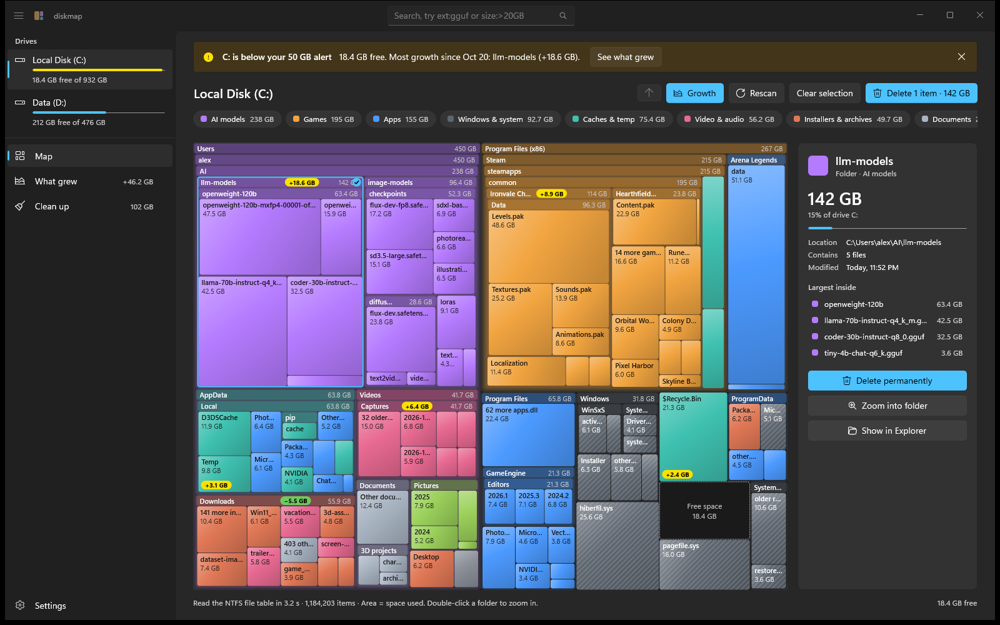
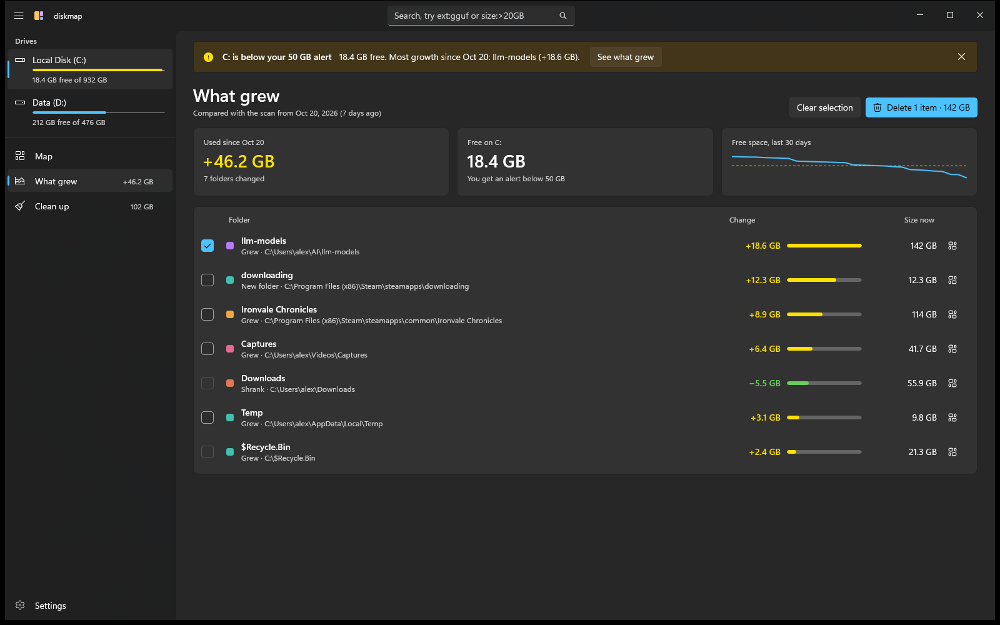
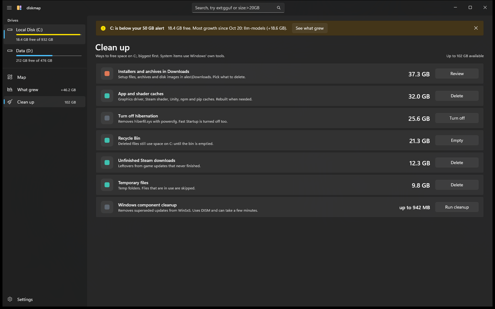
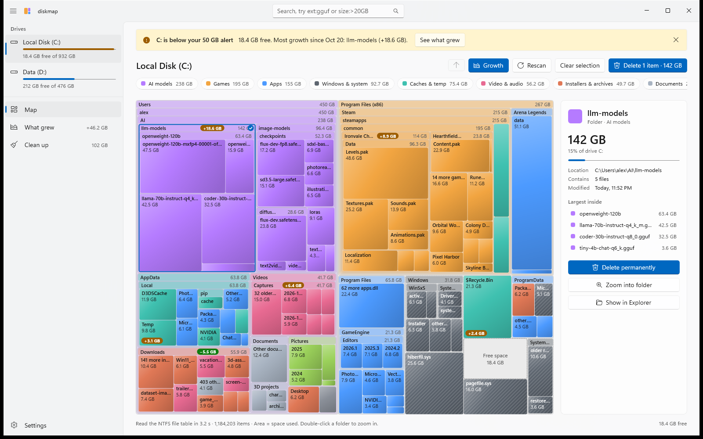

# diskmap

**See what's filling your Windows drive, and delete it.**

diskmap draws your whole drive as nested boxes: every folder is a box inside its parent, and each box's
area is the space it uses. Find the culprit, select it, delete it. A tiny tray helper warns you when a drive
runs low, so you find out before Windows starts complaining.



## Download

Get the latest version from **[Releases](https://github.com/m-hallmann/diskmap/releases/latest)**:

| File | What it is |
|---|---|
| `diskmap-win-x64-Setup.exe` | Installer for most PCs. Installs for your user account, no admin rights needed, updates itself. |
| `diskmap-win-x64-Portable.zip` | Portable version. Unzip anywhere and run `diskmap.exe`. Settings stay in the folder. |
| `diskmap-win-arm64-…` | The same for ARM64 PCs (Snapdragon and similar). |

Runs on Windows 10 (version 2004 or later) and Windows 11. Everything it needs is included; you don't
have to install .NET or anything else.

> **"Windows protected your PC"?** The downloads aren't code-signed yet, so Windows SmartScreen may warn
> you the first time. Click **More info → Run anyway**. The builds are made by GitHub Actions straight from
> this repository; see [`.github/workflows/release.yml`](.github/workflows/release.yml).

## What it does

- **Map**: the whole drive at once, folders inside folders, coloured by what's in them (games, AI models,
  video, apps, caches, installers, images, documents, Windows). Double-click to zoom into a folder,
  Backspace to go back up, search with `ext:gguf size:>20GB older:1y` or by name.
- **What grew**: compares each scan with an earlier one and lists the folders that explain the change,
  so "where did 40 GB go since last week?" has a one-click answer.
- **Clean up**: safe, one-click fixes: Recycle Bin, temp files, app and shader caches, unfinished Steam
  downloads, the hibernation file, old restore points and Windows component cleanup.
- **Delete for real**: deleting is permanent by default (the Recycle Bin doesn't free space on the same
  drive). Files that are open in another app are named, and can be deleted at the next restart.
- **Low-space alerts**: the tray helper checks free space every few minutes and shows a notification when
  a drive drops below the limit you set. Click it to see what grew.

| What grew | Clean up |
|---|---|
|  |  |

Light theme:



## Correct sizes

diskmap counts what a file really occupies on disk, once:

- **Hardlinks are counted once.** Windows keeps many files under two or three names (for example in
  `System32` and `WinSxS`); tools that add up every name show those folders far bigger than they are.
- **Links aren't followed.** Junctions, symbolic links and app execution aliases count as 0 bytes where
  they point from, and the target is counted where it really lives.
- **Compressed, sparse and cloud-only files** count what they use on disk, not their nominal length.
- **Space it can't attribute** (for example folders you can't read) gets its own box when it's
  significant, so the map adds up to what Windows reports as used.

## Admin rights

With admin rights diskmap reads the NTFS master file table directly: scanning a drive with two million
files takes around ten seconds, and hardlinks are detected exactly. Without admin rights it walks the
folders instead, which is slower and can't see hardlinks or some system folders; the app offers
**Restart as administrator**.

If you turn on **Start with Windows** while diskmap runs as administrator, the tray helper is registered
as a scheduled task that starts at sign-in with admin rights, so opening diskmap from the tray needs no
UAC prompt.

## What it won't delete

Windows-managed space (the `Windows` folder, `WinSxS`, `pagefile.sys`, `hiberfil.sys`, restore points,
NTFS metadata) is striped in the map and can only be cleaned with Windows' own tools (DISM, powercfg,
System Restore). Structural folders such as `C:\Users`, your profile folder, `AppData`, `Downloads` and
`Program Files` can't be deleted as a whole either; their contents can.

## Privacy

diskmap has no telemetry and no account. The only network access is the update check against this
repository's GitHub Releases, which you can turn off in Settings. Settings, scan history (folder totals
only) and a small log are stored in a `data` folder next to the app.

## Build from source

You need the [.NET 10 SDK](https://dotnet.microsoft.com/download). The tray helper is compiled with
NativeAOT for release builds, which also needs the Visual Studio "Desktop development with C++" workload;
plain builds work without it.

```powershell
dotnet test tests\DiskMap.Core.Tests
dotnet build src\DiskMap.App -p:Platform=x64
dotnet build src\DiskMap.Tray
src\DiskMap.App\bin\x64\Debug\net10.0-windows10.0.26100.0\win-x64\DiskMap.exe --demo
```

`--demo` shows a made-up drive (handy for trying things without touching anything). Builds from source
keep their data in `%LOCALAPPDATA%\diskmap-dev`.

| Folder | What it is |
|---|---|
| `src/DiskMap.Core` | Scanners (NTFS master file table and folder walk), tree, layout, search, history, delete and cleanup |
| `src/DiskMap.App` | WinUI 3 app (Windows App SDK, unpackaged); the map is drawn with Win2D |
| `src/DiskMap.Tray` | Tray helper: plain Win32, NativeAOT, about 2.6 MB on disk and 5 MB of memory |
| `tests/DiskMap.Core.Tests` | Unit tests for the core |

Releases are built by [GitHub Actions](.github/workflows/release.yml) when a `v*` tag is pushed and
packaged with [Velopack](https://velopack.io), which also provides the installer, portable zip and updates.

## License

[MIT](LICENSE)
